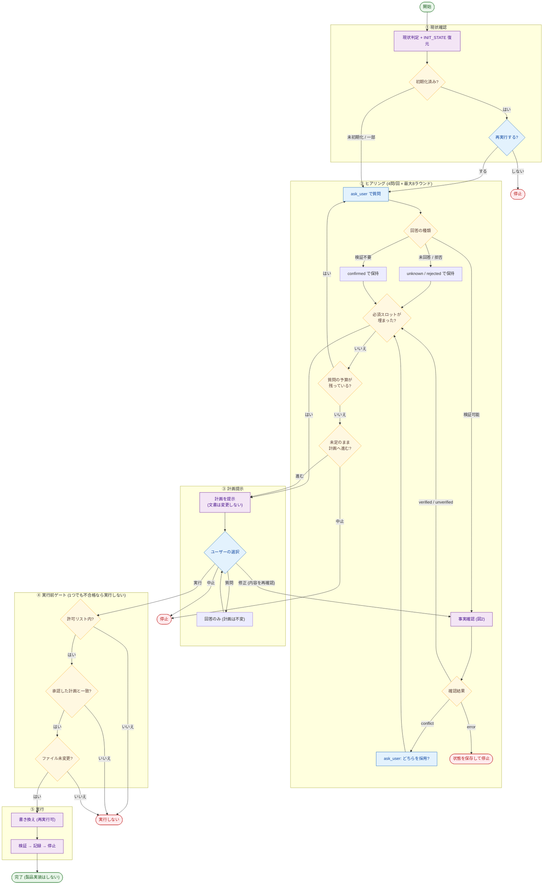
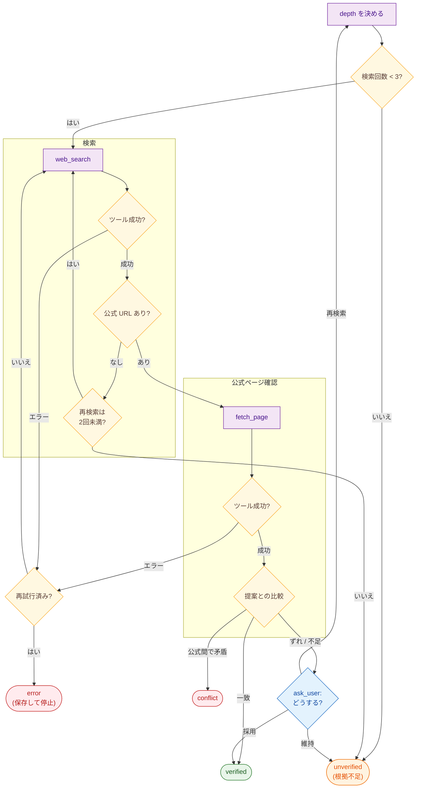

# Project Init — 新規プロジェクトの初期設定

> テンプレートを実プロジェクトに合わせる。**承認前にプロジェクト文書を書き換えない。**
> 流れは **事実確認 → 要件確定 → 計画承認 → 実行 → 検証**。混ぜない。
> 製品機能は実装しない。

**Bun CLI 入口**: 人間が初期設定するなら `bun run setup --help`、対話式 `bun run setup`、自動化は `bun run setup --yes --apply ...`。CLI は OS 導入を毎回確認し、文書は削除せず整理候補を案内する。Agent と進める場合は以下の計画承認ワークフローを使う。

## いつ使うか

- GitHub の「Use this template」直後の最初のセッション
- `AGENTS.md §6.1` が例示のまま、`README.md` が `TEMPLATE_REPO` のまま
- `.agent/skills/project-overview/SKILL.md` がテンプレートの説明のまま
- ユーザーが「初期設定して」「プロジェクトに合わせて書き換え」と依頼したとき

**使わないとき**

- すでに §6 が埋まっていて、個別機能の実装に入っている → 通常ワークフロー
- テンプレート本体（本リポジトリ）の改善 → 本スキルの対象外
- 技術選定だけしたい → [`tech-stack`](../tech-stack/SKILL.md) を単体で使う

## 鉄則

1. **承認前にプロジェクト文書を書き換えない。** 例外は `docs/planning/INIT_STATE.md` のみ（スロットと予算の作業記憶）。
2. **推測で埋めない。** 不明点は `ask_user`（`AGENTS.md §7.4`）。
3. **検証可能な事実は計画に載せる前に確認する。** 順序は必ず `web_search` → 公式 URL 判定 → `fetch_page`。見つからないのは異常ではなく **`unverified`（根拠不足。間違いではない）**。
4. **ループは予算で止める。** 回数上限に達したら回し続けない。失敗時も状態を保存して終了する。
5. **汎用規約を壊さない。** `AGENTS.md` の §1〜§5・§7・§8 は削らない。書くのは §6。
6. **実行は 3 条件をすべて満たしてから。** 許可リスト内 **かつ** 承認済み計画と一致 **かつ** 対象ファイルに未承認の変化がない。再実行は冪等。
7. **完了後に停止する。** 製品機能の実装は次の指示を待つ。

## 既存スキルとの役割分担

| 局面 | 使うスキル | 本スキルがやること |
| :--- | :--- | :--- |
| ユーザー提案の事実確認 | [`documentation-lookup`](../documentation-lookup/SKILL.md) / [`search-first`](../search-first/SKILL.md) / [`deep-research`](../deep-research/SKILL.md) | 通常は本スキルの事実確認ループ。深掘りが必要なら `read_file` |
| 意図の深掘り | [`brainstorming`](../brainstorming/SKILL.md) | 通常は `ask_user`。枠に収まらないときだけ切替 |
| 他人が持つ情報 | [`to-questionnaire`](../to-questionnaire/SKILL.md) | 本人が答えられないスロットだけ |
| 計画の穴 | [`grilling`](../grilling/SKILL.md) | ユーザー希望時、または未決の分岐が残るとき |
| 技術・検証の記録 | [`tech-stack`](../tech-stack/SKILL.md) | §6.1 の書式 |
| 品質ゲート | [`ci-quality-gates`](../ci-quality-gates/SKILL.md) | Bun の検証を調整するとき |
| 文書の整合 | [`docs-maintenance`](../docs-maintenance/SKILL.md) | 実行後。内部リンクは `bash`、外部 URL は `fetch_page` |
| 書き換え対象 | [`project-overview`](../project-overview/SKILL.md) | **読む対象ではなく、書き換える対象** |

## 予算（セッションあたり）

上限到達は失敗ではない。その項目を `unverified` または `unknown` にして `ask_user` へ渡す。カウンターは `INIT_STATE.md` に永続化する。

| 資源 | 1 単位の上限 | セッション合計 | 到達時 |
| :--- | :--- | :--- | :--- |
| `ask_user` 1 ラウンド | **4 問**（選択肢 2〜4 + 自由記述） | **8 ラウンド** | 必須が空なら「未定で計画へ / 続けて聞く / 中止」を 1 問だけ出す。続けて聞くは +2 ラウンドまで |
| 1 事実あたり `web_search` | **3 回**。depth `\"3\"` は **1 回まで** | **12 回** | その事実は `unverified` |
| 1 事実あたり `fetch_page` | **3 URL**（`chunkIndex` 継続は回数に含めない） | **12 回** | その事実は `unverified` |
| 1 事実の「再検索」 | **2 回** | — | 3 回目は出さず `unverified` でユーザー判断 |
| 計画修正ラウンド | — | **6 回** | 「この計画で実行 / 中止」の 2 択だけ出す |

検索回数（`search_count`）とページ取得数（`fetch_count`）と depth は **別カウンタ**。混ぜない。

## スロット状態

値の有無だけでは足りない。経緯を持つ。

| state | 意味 | 計画に載せるとき |
| :--- | :--- | :--- |
| `unknown` | 未質問 | 必須なら質問する。任意なら「未定」 |
| `proposed` | ユーザーが言った。未確認 | 検証対象なら 1b へ。検証不要なら `confirmed` にする |
| `confirmed` | ユーザーが確定。検証不要（目的・名前・好み） | そのまま載せる |
| `verified` | 事実確認で一致 | 公式の言い方で載せる |
| `unverified` | 根拠不足・公式なし・予算切れ。**間違いという意味ではない** | **「未確認」と明示して載せる**（正常） |
| `conflict` | 公式情報同士が矛盾 | 載せない。先に `ask_user` で採用側を決める |
| `rejected` | ユーザーが却下 | 載せない |

事実確認ループの **結果（result）** はスロット state とは別に 4 つ。誤った前提で計画を作らない。

| result | 次のスロット state | 意味 |
| :--- | :--- | :--- |
| `verified` | `verified` | 公式と一致 |
| `unverified` | `unverified` | 根拠不足。間違いではない |
| `conflict` | `conflict` | 公式間で矛盾 → ユーザー判断が必要。勝手に選ばない |
| `error` | **変えない**（`proposed` のまま） | ツール失敗。1 回再試行し、だめなら `last_error` を保存して停止 |

各スロットが持つ欄:

| 欄 | 内容 |
| :--- | :--- |
| `id` | `domain` / `goal` / `success` / `name` / `non_goals` / `stack` / `verify` / `constraints` / `prune_skills` |
| `value` | 現在値。空なら `unknown` |
| `state` | 上表 |
| `source` | `user` / `web_search` / `fetch_page` / `repo` |
| `evidence` | `[id](url)` またはファイルパス |
| `verified_at` | 確認した日時（JST）。未確認なら空 |
| `confidence` | `high` / `medium` / `low` |
| `depends_on` | 再検証が必要なとき、依存するスロット id |
| `reason` | 更新理由（誰が・なぜこの値にしたか） |

検証不要（事実確認しない）: `goal` / `success` / `name` / `non_goals`
検証する: `stack` / `verify` / `constraints` のうち、版・ライブラリ・API・ライセンス・「標準/非推奨」の主張

作業記憶は `docs/planning/INIT_STATE.md` に書く（承認前に書いてよい唯一のファイル）。中断後はこれを `read_file` して再開する。**確定スロットはリセットしない。**

### INIT_STATE 型

```yaml
phase: detect | ask | fact | plan | execute | done
approved: false          # ユーザーが「実行する」と言ったあとだけ true
approved_at: ""          # JST。未承認なら空
plan_hash: ""            # 承認した計画本文の sha256。実行前に再計算して照合
budgets:
  ask_rounds_used: 0     # max 8
  search_used: 0         # max 12
  fetch_used: 0          # max 12
  plan_revisions: 0      # max 6
slots:
  - id: domain
    value: ""
    state: unknown       # unknown|proposed|confirmed|verified|unverified|conflict|rejected
    source: ""
    evidence: ""
    verified_at: ""
    confidence: ""
    depends_on: []
    reason: ""
facts:
  - claim: ""
    slot_id: stack
    search_count: 0      # この事実の web_search。max 3
    fetch_count: 0       # この事実の fetch_page URL 数。max 3
    retry_search: 0      # 再検索。max 2
    last_error: ""
    result: ""           # verified|unverified|conflict|error|""
snapshots: []            # 承認時点の {path, sha256}。実行直前に変化がないか見る
```

人間が読む表形式でもよい。欠けている欄は空で復元する。

---

## 進行

全体。必須判定と予算判定は分ける。実行は 3 ゲート。事実確認の内部は次図。



事実確認。順序は `search_count` → `web_search` → 公式 URL → `fetch_page`。入れ替えない。



---

### ノードの入出力

| ノード | 入力 | 出力 | 次へ進む条件 |
| :--- | :--- | :--- | :--- |
| 0 現状判定 | リポジトリ、`INIT_STATE.md` | `phase` / slots / budgets | 未初期化・一部 → ASK。済み → 再実行確認。未コミット変更あり → 停止 |
| ask_user | `unknown` スロット、残ラウンド | 更新された slots、`ask_rounds_used++` | 検証可能値 → FACT。検証不要 → `confirmed` → 必須判定 |
| 事実確認 | `proposed`、その事実の `search_count` / `fetch_count` | `result` とスロット更新 | 下表の result どおり。`error` は保存して停止 |
| 必須判定 | 必須スロットの state | bool | **Yes なら予算が残っていても PLAN**。No だけ予算判定へ |
| 予算判定 | `ask_rounds_used` | bool | 残りあり → ASK。切れ → 未定で計画 / 中止の 1 問 |
| 計画提示 | slots、budgets | 計画本文（文書は触らない） | 4 択。質問は計画不変。修正は差分 1b |
| 実行ゲート | `approved`、`plan_hash`、許可リスト、`snapshots` | go / no-go | 3 条件すべて Yes のときだけ書き換え |
| 書き換え | 許可リストのパス | git diff | リスト外は戻す。実質同じなら触らない |
| 検証・停止 | 変更ファイル | 記録、commit | 製品実装を始めない |

---

### 0. 現状判定

`read_file` / `bash` で確認する。ユーザーに聞ける事実は聞かない。`INIT_STATE.md` があれば復元し、予算とスロットを再利用する。確定済み（`confirmed` / `verified` / `rejected`）はリセットしない。

| 確認 | 未初期化の目安 |
| :--- | :--- |
| `README.md` 先頭 | `# TEMPLATE_REPO` のまま |
| `AGENTS.md §6.1` | 「（例）」や空の検証コマンド |
| `project-overview/SKILL.md` | 「汎用エージェント作業テンプレート」 |
| `docs/planning/INIT_PLAN.md` | 無い |

- **未初期化** → Phase 1。
- **一部** → 埋まっているスロットは `confirmed` / `verified` として質問しない。
- **初期化済み**（`INIT_PLAN.md` があり、`product.md` がテンプレでない）→ 再実行するか、上書き範囲を `ask_user`。勝手に上書きしない。再実行は Phase 4 の冪等ルールに従う。

未コミット変更があるときは混ぜず停止する（`AGENTS.md §4.1`）。

---

### 1. ask_user ループ

**1 回あたり最大 4 問。セッション合計 8 ラウンド。** 全体 4 問ではない。回数は `INIT_STATE.budgets.ask_rounds_used`。

すでに `confirmed` / `verified` / `unverified` / `conflict` / `rejected` のスロットは聞かない。`unknown` だけ聞く。

応答の分岐:

| 応答 | 次 |
| :--- | :--- |
| 値を選んだ / 書いた | 検証不要 → `confirmed`。検証可能 → `proposed` にして 1b |
| 不明・分からない | 任意 → `unknown` のまま「未定」。必須 → 言い方を変えて **あと 1 回だけ**。それでも空なら `unverified`（必須の未定） |
| 拒否・答えたくない | `rejected`。必須が `rejected` なら計画へ進めず、中止か未定かを 1 問 |
| スキップして進めて | 必須が空 → 必須だけ聞く。任意 → `unknown`。進行中の事実 → `unverified` |

必須スロット: `domain` / `goal` / `success`
任意: `name` / `non_goals` / `stack` / `verify` / `constraints` / `prune_skills`（既定は削除しない）

ラウンド例（埋まっている問は飛ばす）:

**Round 1** 分野、成果物、成功条件、非目標
**Round 2** 技術、検証、制約、skill 削除

`brainstorming` へ切替: 分野が「その他」、目的が一言で言えないとき。
`to-questionnaire` へ切替: 答えが別担当の頭にあるとき。

**抜けは 2 段で判定する（混ぜない）:**

1. **必須スロットが埋まったか**（`confirmed` / `verified` / `unverified`（未定と明示）で、進行中の 1b が無い）→ Yes なら **予算が残っていても** 計画へ。
2. No のときだけ ask 予算を見る。残りあり → 質問継続。切れ → 1 問「未定で計画へ / 中止」。ユーザーが「計画を出して」も計画へ。

抜けたあと、進行中の `proposed` が残っていれば 1b を先に完了させる。

---

### 1b. 事実確認ループ

`proposed` の検証可能事実だけ。好み・目的・名前は対象外。

**接続順（入れ替え禁止）:**

1. この事実の `search_count` が 3 未満か判定する
2. 未満なら `web_search` を呼び、`search_count` と `search_used` を加算する
3. 結果から公式 URL かどうかを判定する
4. 公式 URL なら `fetch_page` し、`fetch_count` と `fetch_used` を加算する

`search_count < 3` の Yes を `fetch_page` に直接つながない。

**上限到達・公式なし・本文なし = 異常ではない。`unverified`（根拠不足）にしてユーザーへ返す。**

| 内容 | 最初の depth | 上げられる上限 |
| :--- | :--- | :--- |
| 公式 URL・パッケージ名・版の有無 | `\"1\"` | `\"2\"` まで |
| 比較・ライセンス・複数ソース | `\"2\"` | `\"3\"` まで 1 回 |
| API 詳細・長い仕様・セキュリティ | `\"3\"` | 上げない。`fetch_page` する |

手順:

1. 提案を 1 文にする。`facts[]` に `claim` が無ければ追加する。
2. この事実の `search_count` が 3 未満なら `web_search`。達していれば result=`unverified`。

```json
{
  "query": "<公式名> official docs <論点>",
  "depth": "<上表>"
}
```

3. 公式 URL があれば `fetch_page`（1 事実 3 URL まで）。`hasMore` なら同じ URL の `chunkIndex` を進める（回数に含めない）。
4. ツールが失敗したら result=`error`。同じ呼び出しを **1 回だけ** 再試行。だめなら `last_error` を書いて **停止**（計画を出さない）。
5. 公式が 2 件以上あり内容が矛盾したら result=`conflict`。`ask_user` で採用側を決める。勝手に選ばない。
6. 表で報告する。引用は `[id](url)`。推測と事実を分ける。

| 提案 | 結果 | 出典 | result |
| :--- | :--- | :--- | :--- |

7. **一致** → result=`verified`、`source=fetch_page` または `web_search`、`verified_at`、`confidence`、`reason`。
8. **ずれ / 不足** → `ask_user`:
   - 公式を採用する（`verified`、値は公式側）
   - 提案を維持する（`unverified`）
   - 再検索する（残回数があるときだけ出す）
9. 再検索の残が 0、またはセッションの search/fetch 合計上限 → 選択肢から再検索を外し、採用か維持だけ。

修正時（Phase 3）は **`value` または `state` が変わったスロットと、`depends_on` でそれを指すスロットだけ** 1b する。最初から全部検索し直さない。

---

### 2. 計画の提示

チャットに出す。**プロジェクト文書は触らない。** `INIT_STATE.md` の更新は可。

必ず含める:

1. スロット表（id / value / state / evidence / confidence / reason）
2. 書き換え対象（触らないファイルも明示）= 許可リスト
3. スキル（残す / 削除。削除は承認があるものだけ）
4. 最初のタスク 1〜3 件（製品実装を含めない）
5. やらないこと
6. 予算の消費（ask_rounds / search / fetch）
7. 各検証可能スロットの result（`verified` / `unverified` / `conflict`）。`conflict` が残っていたら計画承認に進まない

`ask_user` の 4 択は責務が違う:

| 選択肢 | 計画 | 次 |
| :--- | :--- | :--- |
| **実行する** | 不変。承認 | Phase 4。`approved: true`、`plan_hash`、`snapshots` を書く |
| **修正する** | 変わる | 変更スロットだけ 1b → 計画を再生成 → 再承認 |
| **質問する** | **不変** | 疑問に答える。スロットも計画も変えない。終わったら同じ 4 択 |
| **中止する** | 捨てる | プロジェクト文書は触らず停止。`INIT_STATE.md` は残してよい |

「実行して」「Go」「承認」以外で Phase 4 に進まない。計画修正は 6 ラウンドまで。達したら実行か中止の 2 択。

---

### 3. 計画ループの詳細

- **質問**: 計画本文を書き換えない。回答はチャットだけ。
- **修正**: ユーザーが指定したスロットだけ `proposed` に戻す。依存スロットも再検証。差分だけ計画に出す。
- **grilling**: ユーザーが「詰めて」と言ったとき、または未決分岐が残るとき。1 ラウンド。予算は ask に含む。
- **中止**: 実行しない。

---

### 4. 実行（許可リストと承認を分ける）

実行前に **3 条件をこの順で** 見る。1 つでも No なら書かない。

| # | 条件 | 見方 | No のとき |
| ---: | :--- | :--- | :--- |
| 1 | 操作が許可リスト内か | 計画のファイル一覧に無いパス・削除・新規は拒否 | 実行しない。計画を出し直す |
| 2 | ユーザーが承認した計画と一致するか | `approved === true` かつ計画本文の sha256 が `plan_hash` と一致 | 実行しない。再承認を取る |
| 3 | 対象ファイルに未承認の変化が無いか | 各パスの sha256 が `snapshots` と一致（ファイルが無い予定なら無いこと） | 実行しない。差分を見せて再承認 |

許可リスト内でも、承認範囲を超える変更はしない。

手順:

1. 上の 3 条件を満たすこと。
2. 承認内容を `docs/planning/INIT_PLAN.md` に書く（スロット表 + ファイル許可リスト）。
3. **許可リストに無いパスは変更しない。** 実行後 `bash` で `git diff --name-only` し、許可リスト外があれば戻して報告する。
4. 各ファイルは「計画の内容と実質同じなら触らない」（冪等）。既存のタスク行は増やさず状態更新のみ。
5. 再実行で skill を消すのは、計画に「削除」と書いてあり、かつユーザーが再承認した場合だけ。

順:

| 順 | ファイル | 書くこと |
| ---: | :--- | :--- |
| 1 | `docs/planning/INIT_PLAN.md` | 承認済み計画 |
| 2 | `docs/arch/product.md` | 目的・対象・非目標・用語 |
| 3 | `AGENTS.md` **§6 のみ** | 環境・検証・制約 |
| 4 | `.agent/rules/project-template.md` | §6 と揃える |
| 5 | `.agent/skills/project-overview/SKILL.md` | このプロジェクトの全体像 |
| 6 | `README.md` | 概要・使い方 |
| 7 | `docs/arch/architecture.md` / `milestones.md` | 最小限 |
| 8 | `docs/task-list.md` | 承認した最初のタスク |
| 9 | `docs/README.md` | 目次 |
| 10 | `package.json` の検証・セットアップ設定 | §6.1 に書いたときだけ |
| 11 | `.agent/skills/` の削除 | 計画で承認されたものだけ。`index.md` も同じ変更 |

`docs/examples/` のような存在しないパスを新たに書かない。

---

### 5. 検証・記録・停止

1. [`docs-maintenance`](../docs-maintenance/SKILL.md)。内部リンクは `bash`、外部 URL は `fetch_page`。
2. `make links`。§6.1 があればそれも（`make check`）。未記録のコマンドは捏造しない。
3. `docs/task-list.md` を証拠つきで更新。
4. `.agent/hooks/log-task.md`。
5. 検証 PASS なら commit し、セッション固定ブランチへ push。
6. `AGENTS.md §7.2` で報告し、**停止する。**

## 完了条件

- [ ] 必須スロットが `confirmed` / `verified` / `unverified`（未定と明示）
- [ ] 検証可能提案に `proposed` も `conflict` も残っていない
- [ ] `error` のまま計画していない（失敗は保存して停止）
- [ ] 予算超過で回し続けていない
- [ ] `INIT_PLAN.md` があり、`INIT_STATE.approved` が true、`plan_hash` が一致
- [ ] 変更ファイルが許可リストと一致し、snapshots から未承認の変化が無い
- [ ] `AGENTS.md` の汎用節が無関係に変わっていない
- [ ] `make links` が PASS
- [ ] 製品機能は実装していない

## よくある失敗

| 失敗 | 正しい動き |
| :--- | :--- |
| `search_count` 未満を `fetch_page` に直接つなぐ | `web_search` → 公式 URL 判定 → `fetch_page` |
| 必須判定と質問予算を 1 条件にする | 必須が埋まったら計画へ。予算は埋まっていないときだけ |
| `unverified` を誤りとして扱う | 根拠不足。計画には「未確認」と書いて載せる |
| 公式の矛盾を片方で上書きする | `conflict`。ユーザーが選ぶ |
| ツールエラーを `unverified` にする | `error`。再試行 → 保存して停止 |
| 許可リスト内なら承認なしで書く | 許可リスト **かつ** 承認計画一致 **かつ** ファイル未変化 |
| 見つからないので検索し続ける | 上限で `unverified`。ユーザー判断 |
| 「最大 4 問」をセッション全体だと思う | 1 ラウンドの上限。全体は 8 ラウンド |
| 「質問する」で計画を書き換える | 計画は不変。修正だけが書き換える |
| 修正のたびに全件検索 | 変わったスロットと `depends_on` だけ |
| 承認前に README を書く | `INIT_STATE.md` 以外は触らない |
| 再実行でタスク行を増やす | 既存行の状態更新のみ |
