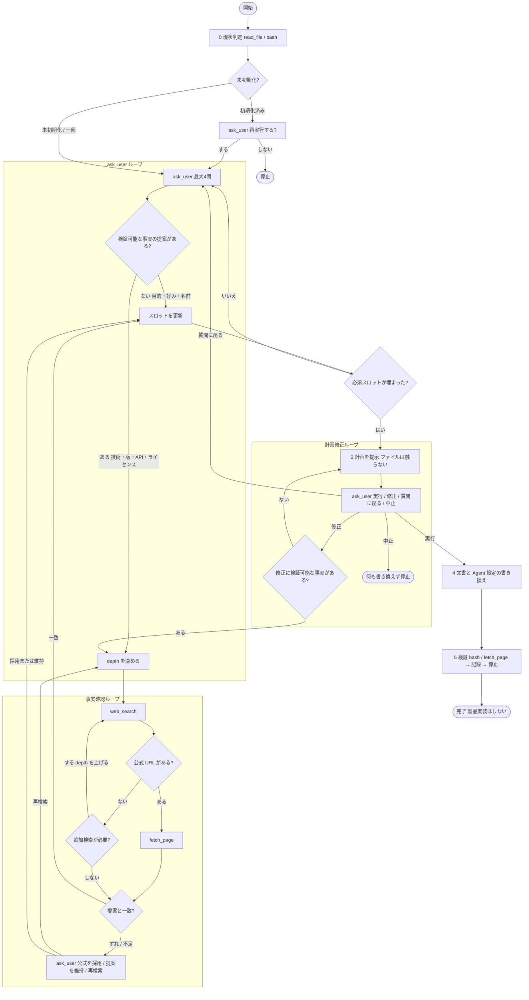
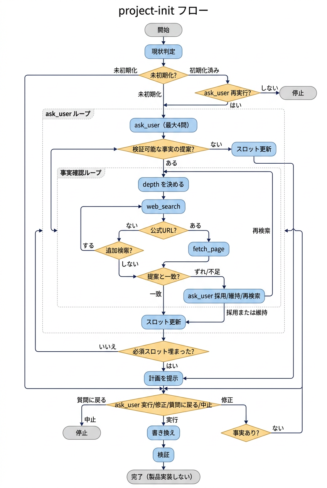

# Project Init — 新規プロジェクトの初期設定

> テンプレートを実プロジェクトに合わせる。**承認前にファイルを書き換えない。**
> 勝手に機能実装を始めない。意図の確認 → 計画の承認 → 文書と Agent 設定の書き換え、の順だけを行う。

## いつ使うか

- GitHub の「Use this template」直後の最初のセッション
- `AGENTS.md §6.1` が例示のまま、`README.md` が `TEMPLATE_REPO` のまま
- `.agent/skills/project-overview/SKILL.md` がテンプレートの説明のまま
- ユーザーが「初期設定して」「プロジェクトに合わせて書き換え」と依頼したとき

**使わないとき**

- すでに §6 が埋まっていて、個別機能の実装に入っている → 通常ワークフロー
- テンプレート本体（本リポジトリ）の改善 → 本スキルの対象外
- 技術選定だけしたい → [`tech-stack`](../tech-stack/SKILL.md) を単体で使う

## 鉄則

1. **承認前に書き換えない。** 質問・事実確認・計画の提示だけ行う。
2. **推測で埋めない。** 不明点は `ask_user` で聞く（`AGENTS.md §7.4`）。
3. **ユーザー提案の検証可能な事実は、計画に載せる前に確認する。** `web_search`（内容で `depth` を変える）→ 公式 URL は `fetch_page`。
4. **汎用規約を壊さない。** `AGENTS.md` の §1〜§5・§7・§8 は削らない。書くのは §6。
5. **既存スキルを再発明しない。** 局面ごとに下表のスキルを読む。
6. **初期設定の完了後に停止する。** 製品機能の実装は次の指示を待つ。

## 既存スキルとの役割分担

本スキルはオーケストレーター。詳細手順は既存スキルに任せる。

| 局面 | 使うスキル | 本スキルがやること |
| :--- | :--- | :--- |
| ユーザー提案の事実確認 | [`documentation-lookup`](../documentation-lookup/SKILL.md) / [`search-first`](../search-first/SKILL.md) / [`deep-research`](../deep-research/SKILL.md) | 通常は本スキルの事実確認ループ。深掘りが必要ならこれらのスキルを `read_file` |
| 意図の深掘り（枠に収まらない・なぜが不明） | [`brainstorming`](../brainstorming/SKILL.md) | 通常は `ask_user` のラウンドで足りる。自由記述が必要なら切り替える |
| 他人が持つ情報の回収 | [`to-questionnaire`](../to-questionnaire/SKILL.md) | ユーザー本人が答えられないスロットだけ委譲する |
| 計画の穴・未決の分岐 | [`grilling`](../grilling/SKILL.md) | ユーザーが希望したとき、または計画に矛盾・未決が残るとき |
| 技術・検証コマンドの記録 | [`tech-stack`](../tech-stack/SKILL.md) | 選定結果を §6.1 に書く書式は tech-stack に従う |
| 品質ゲートの揃え方 | [`ci-quality-gates`](../ci-quality-gates/SKILL.md) | `PROJECT_CHECKS` を足すときだけ読む |
| 重い技術判断の記録 | [`architecture-decision-records`](../architecture-decision-records/SKILL.md) | 「なぜこのスタックか」が後で効くときだけ ADR を足す |
| 文書の整合 | [`docs-maintenance`](../docs-maintenance/SKILL.md) | 書き換え後に `bash` で `make links`、外部 URL は `fetch_page` |
| 書き換え対象 | [`project-overview`](../project-overview/SKILL.md) | **読む対象ではなく、書き換える対象** |
| 埋める項目のチェック | [`.agent/rules/project-template.md`](../../rules/project-template.md) | 手順の正本は本スキル。ルールは項目一覧 |

## 進行（必ずこの順）



図: 

---

---

### 0. 現状判定

次を確認し、表で報告する。ユーザーに聞ける事実は聞かない。

| 確認 | 未初期化の目安 |
| :--- | :--- |
| `README.md` 先頭 | `# TEMPLATE_REPO` のまま |
| `AGENTS.md §6.1` | 「（例）」や空の検証コマンド |
| `project-overview/SKILL.md` | 「汎用エージェント作業テンプレート」 |
| `docs/task-list.md` 未完了サマリー | なし / 例行のみ |
| `docs/arch/product.md` | テンプレートの目的のまま |

- **未初期化** → Phase 1 へ。
- **一部だけ埋まっている** → 埋まっているスロットは質問しない。差分だけ計画に出す。
- **初期化済み** → 「再実行しますか（上書き範囲を指定）／しません」を `ask_user` で確認する。勝手に上書きしない。

未コミット変更があるときは混ぜず停止する（`AGENTS.md §4.1`）。

---

### 1. ask_user ループ（意図の確認）

**止まらない。** 必須スロットが埋まるまで `ask_user` を繰り返す。1 ラウンド最大 4 問、選択肢 2〜4 + 自由記述。すでに埋まっているスロットは聞かない。

各ラウンドのあと、返ってきた提案に **検証可能な事実** があれば Phase 1b に入る。事実確認が終わるまで次ラウンドの計画提示には進まない。

ユーザーが「スキップして進めて」と言った場合:

- **必須スロットが空** → それだけ聞いてから進む（スキップ不可）。
- **任意スロット** → 「未定」と明示して計画へ進む。
- **未確認の事実提案** → 「未確認」と書いて進むか、1 回だけ事実確認するかを `ask_user`。勝手に正しいとしない。

#### 必須スロット（空なら計画に進まない）

| スロット | 聞くこと |
| :--- | :--- |
| 分野 | ソフトウェア / 文書 / 調査 / データ / 設定・運用 / その他 |
| 目的 | 何を、誰のために、なぜ今作るか（1〜3 文） |
| 成功条件 | 第三者が Yes/No できる完了の目安 |

#### 任意スロット（スキップ可。未定と書く）

| スロット | 聞くこと | 未定のときの扱い |
| :--- | :--- | :--- |
| 名前 | リポジトリ・プロダクト名 | ディレクトリ名を仮名にする |
| 非目標 | やらないこと | 「未記入」 |
| 技術スタック | 言語・ランタイム・主要ツール | §6.1 に「未定」。後で `tech-stack` |
| 検証手段 | 型・Lint・テスト・ビルド等 | 分野の最低限を提案し、計画で確認する |
| 制約 | 外部 API / 秘密情報 / 書けないディレクトリ | なし |
| スキル削除 | 分野に合わない skill を削るか | **削除しない**（残す） |

#### ラウンド例（スクリプトではない。埋まっている問は飛ばす）

**Round 1（分野と目的）**

1. 分野（上記の選択肢）
2. 最初に届けたい成果物（動くアプリ / 文書一式 / 調査レポート / 設定・手順 / その他）
3. 成功したら何が言えるか（自由記述可）
4. 今回やらないこと（未定でも可）

**Round 2（手段。Round 1 の答えに依存）**

1. 決まっている技術（未定 / 既存コードに合わせる / 指定する）
2. 検証を何で担保するか（提案を出して選ばせる）
3. 環境制約の有無
4. 使わない skill を削るか（残す / 提案を見てから決める / 削る）

必要なら Round 3 以降を足す。**一度に全部聞かない。**

`brainstorming` へ切り替える条件: 分野が「その他」、目的が一言で言えない、ユーザーが自由に話したい、と分かったとき。切り替えたら「スキップして始めてよい」旨を先に伝え、質問は 1 つずつにする。

`to-questionnaire` へ切り替える条件: 答えがユーザーではなく別の担当者の頭にあるとき。

ループを抜ける条件（すべて満たす）:

- 必須スロットが埋まっている
- 未解決の事実確認が無い（一致 / ユーザーが維持を選んだ / 未確認と明示）
- ユーザーが「計画を出して」と言った、または次に聞く必須が無い

---

### 1b. 事実確認ループ（ユーザー提案）

ユーザーが出した **検証可能な事実** は、計画に載せる前に確認する。好み・目的・名前は確認しない。

| 確認する | 確認しない |
| :--- | :--- |
| 言語・ライブラリ・版・パッケージ名 | 「シンプルにしたい」などの好み |
| API・設定キー・破壊的変更 | 目的・非目標・成功条件 |
| 公式ドキュメントの URL・ライセンス | プロダクト名 |
| 「これが標準」「もう非推奨」 | リポジトリ内の事実（`read_file` / `bash` で足りる） |

#### depth の決め方（`web_search` の `depth`）

| 内容 | depth | 理由 |
| :--- | :--- | :--- |
| 公式 URL・パッケージ名・最新安定版の有無 | `"1"` | 名前と URL が取れれば足りる |
| 技術選定の比較、ライセンス、複数ソースの一致 | `"2"` | 公式と二次情報を突き合わせる |
| API の詳細、長い仕様、セキュリティ・法務 | `"3"` | 本文が必要。続けて `fetch_page` |

同じ提案を depth `"3"` で 2 回以上回さない。足りなければ不足と書いて `ask_user`。

#### 1 周の手順

1. 提案を 1 文に圧縮する（例: 「API は Next.js 15 の App Router」）。
2. `web_search` を呼ぶ。

```json
{
  "query": "<公式名> official docs <論点>",
  "depth": "<上表>"
}
```

3. 公式ドメインの URL があれば `fetch_page`。`hasMore` なら `chunkIndex` を進める。

```json
{
  "url": "https://<公式>"
}
```

4. 結果を表で出す。推測と事実を分ける（`AGENTS.md §7.3`）。引用は `[id](url)`。

| 提案 | 確認結果 | 出典 | 次 |
| :--- | :--- | :--- | :--- |
| … | 一致 / ずれ / 不足 | `[n](url)` | 採用 / 確認 / 再検索 |

5. **一致** → スロットに公式の言い方で書く。ループを抜ける。
6. **ずれ / 不足** → `ask_user`（最大 4 問に収め、この確認を優先）:

- 公式の内容を採用する
- ユーザー提案を「未確認」として維持する
- キーワードを変えて再検索する（depth を 1 段上げてよい）

7. 再検索なら手順 2 に戻る。採用/維持ならスロットを更新してループを抜ける。

公式本文が取れないときは学習データで埋めない。「未確認」と書いて `ask_user`。

詳細なライブラリ質問は [`documentation-lookup`](../documentation-lookup/SKILL.md)、既存実装の有無は [`search-first`](../search-first/SKILL.md) を `read_file` してから同じツールで行う。

---

### 2. 初期設定計画の提示

質問が揃ったら、**チャットに計画を出す。この時点ではファイルを作らない。**

計画に必ず含めるもの:

1. **プロジェクトプロファイル**（名前・分野・目的・非目標・対象・成功条件）
2. **技術と検証**（未定なら未定と書く。捏造しない）
3. **書き換え対象**（ファイルごとの変更内容。触らないファイルも明示）
4. **スキル**（残す / 削除候補。削除はユーザー承認があるものだけ）
5. **最初のタスク**（`docs/task-list.md` に載せる 1〜3 件。製品実装は含めない）
6. **やらないこと**（製品機能の実装、AGENTS.md 汎用節の改変、承認なき skill 削除）

提示の直後に `ask_user`:

- この計画で実行する
- 修正する（どこを、を自由記述）
- 質問に戻る
- 中止する

「実行して」「Go」「承認」が出るまで Phase 4 に進まない。

---

### 3. 計画修正ループ（ask_user）

**止まらない。** 「実行して」または「中止」が出るまで `ask_user` を繰り返す。ファイルはまだ触らない。

- 修正指示は計画に反映し、差分だけ再提示する。全問をやり直さない。
- 修正に検証可能な事実が含まれる → Phase 1b を回してから計画を更新する。
- 矛盾・未決の分岐が残る、またはユーザーが「詰めて」と言った → [`grilling`](../grilling/SKILL.md) を 1 ラウンド（`ask_user`、推奨答つき）。終わったら計画を更新して再承認を取る。
- 「質問に戻る」→ Phase 1 の ask_user ループへ戻る。
- 中止 → 何も書き換えず停止する。

---

### 4. 文書と Agent 設定の書き換え

承認後、先に計画を `docs/planning/INIT_PLAN.md` へ保存する（本スキルの書式。`_TEMPLATE.md` の 12 節は製品実装用なので使わない）。

その後、**上から順に**最小差分で書き換える。

| 順 | ファイル | 書くこと | 触らないこと |
| ---: | :--- | :--- | :--- |
| 1 | `docs/planning/INIT_PLAN.md` | 承認済み計画 | — |
| 2 | `docs/arch/product.md` | 目的・対象・非目標・用語 | テンプレ運用そのものの説明を残しすぎない |
| 3 | `AGENTS.md` の **§6 のみ** | tech-stack の書式で環境・検証・制約・実装ルール | §1〜§5・§7・§8 |
| 4 | `.agent/rules/project-template.md` | §6 と内容を揃える | 他の rules |
| 5 | `.agent/skills/project-overview/SKILL.md` | **このプロジェクトの**全体像に書き換える | 他スキルの本文 |
| 6 | `README.md` | プロジェクト概要・使い方 | ライセンス方針を独断で変えない |
| 7 | `docs/arch/architecture.md` / `milestones.md` | 実プロジェクトの構成・段階 | 不要なら最小限 |
| 8 | `docs/task-list.md` | 承認した最初のタスク。例行は消す | 過去行の削除（追加・状態更新のみ） |
| 9 | `docs/README.md` | 目次を同じ変更で更新 | — |
| 10 | `Makefile` の `PROJECT_CHECKS` | §6.1 に書いた検証があるときだけ | 未定なら触らない |
| 11 | `.agent/skills/` の削除 | **計画で承認された skill だけ** | 承認なき削除。`index.md` も同じ変更で更新 |

スキル削除時は `.agent/skills/index.md` の「読み方ガイド」と「一覧」の両方から落とす。上流由来なら `THIRD_PARTY_NOTICES.md` は残す（ライセンス表示）。

`docs/examples/` のような存在しないパスを新たに書かない。

---

### 5. 検証・記録・停止

1. [`docs-maintenance`](../docs-maintenance/SKILL.md) に従う。内部リンクは `bash`、外部 URL は `fetch_page`。
2. `make links`。§6.1 に検証が書いてあればそれも実行（`make check`）。未記録のコマンドは捏造しない。
3. `docs/task-list.md` の初期設定タスクを証拠つきで更新する。
4. `.agent/hooks/log-task.md` に従いログを残す。
5. 検証 PASS なら Conventional Commits で commit し、セッション固定ブランチへ push する。
6. `AGENTS.md §7.2` の形式で報告し、**停止する。** 「次は何をしますか」と聞く。

## 完了条件

- [ ] 必須スロットがユーザーの言葉で埋まっている（Agent の創作ではない）
- [ ] 検証可能な提案は事実確認済み、または「未確認」と明示されている
- [ ] 計画が承認されている（`INIT_PLAN.md` がある）
- [ ] `AGENTS.md §6`・`project-overview`・`README.md`・`docs/arch/product.md` がこのプロジェクトの話になっている
- [ ] `AGENTS.md` の汎用節が無関係に変わっていない
- [ ] 承認されていない skill 削除が無い
- [ ] `docs/README.md` の目次が追随している
- [ ] `make links` が PASS（その他の記録済み検証も PASS）
- [ ] 製品機能は実装していない

## よくある失敗

| 失敗 | 正しい動き |
| :--- | :--- |
| 承認前に README を書き換える | 計画が承認されるまで読むだけ |
| §1〜§5 をプロジェクト向けに「最適化」する | §6 だけ書く |
| 検証コマンドを想像で書く | 未定と書くか、ユーザーに確認する |
| 使わなそうな skill を独断で削る | 残す。削るのは承認済みのみ |
| 初期設定の勢いで機能実装を始める | 完了報告して停止する |
| `project-overview` をテンプレ説明のまま残す | このプロジェクトの全体像に書き換える |
| 存在しないパス（例: `docs/examples/`）を書く | 実在するパスだけを書く |
| 質問を 10 個一度に出す | `ask_user` 最大 4 問 / 回 |
| ユーザーの技術提案を検索せず計画に書く | Phase 1b。`web_search` → 公式は `fetch_page` |
| すべての検索を depth `"3"` にする | URL 確認は `"1"`、比較は `"2"`、仕様は `"3"` |
